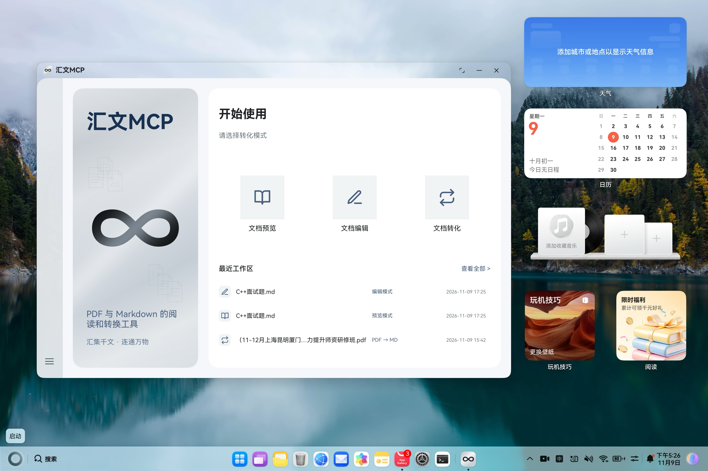
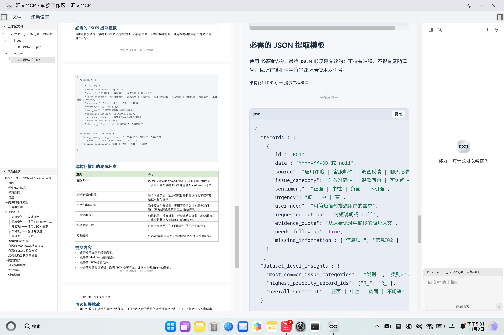

# HuiwenMCP for Harmony

[简体中文](README.md) · [English](README.en.md)

A document reading, Markdown editing and format conversion project for **OpenHarmony / HarmonyOS PC**, built with **Qt, ArkTS, CEF, PDFium and Python HNP**.

Read source documents, compare PDF-to-Markdown results side by side, edit Markdown, and resume work from recent tasks.

## First open in DevEco Studio

**Initialize local configuration before opening the project.** On macOS, double-click `初始化项目.command` in the repository root, or run:

```sh
cd /your/path/HuiwenMCP
bash 初始化项目.command
```

The script creates the root `build-profile.json5` from the unsigned `build-profile.example.json5` only when absent. Existing configuration and personal signing settings are preserved; initialization is needed only once. It does not initialize source submodules or prepare build dependencies.

Open the **repository root**, not `entry/` or `qt_app/`. The project configuration version is `6.1.1`, with target and compatible SDK `6.1.1(24)`; use a compatible DevEco Studio and SDK. Configure your own signing in the IDE when deploying to a device. Personal signing is not needed to recognize the project.

For `Cannot Open Project / Select an OpenHarmony or HarmonyOS project`, first check the selected directory and the generated root `build-profile.json5`, then IDE/SDK compatibility. Dependency setup, compilation and device signing happen later.

Local `build-profile.json5`, `local.properties` and signing materials are Git-ignored; only the unsigned template is shared. Never force-add local configuration or certificates. CI rejects tracked local configuration, common signing-file extensions and signing fields in the template. This is not a comprehensive secret scanner and cannot prevent an initial push of sensitive files. To block merging a failing PR, make `check-local-config` a required branch-protection check; adding the workflow alone does not configure that remote rule.

## Screenshots

### HarmonyOS PC home



### PDF-to-Markdown workspace



These screenshots show a running version before the assistant was moved out. The current `main` branch excludes the right assistant panel and its toggle. Its UI, model settings and local conversations are preserved on `feature/agent-sidebar`; no live model backend is connected.

## Features and scope

| Area | Current scope |
| --- | --- |
| Document reading | PDF, Markdown and DOCX preview; legacy DOC is converted to a temporary DOCX for preview. |
| PDF to Markdown | Text-based PDF conversion, with source and output displayed side by side. |
| Synchronized scrolling | PDF and Markdown follow page position or overall progress; independent scrolling is also available. |
| Markdown editing | Editing, saving and unsaved-change confirmation. |
| Workspaces | Input/output files, document outlines and recent task restoration. |
| Home appearance | Light, dark and system modes; Qt workspace colors are managed separately. |
| Document assistant (separate branch) | UI, conversations and model settings are preserved on `feature/agent-sidebar`; `main` does not build or display the module. |

The assistant branch restores the implementation in a separate commit after its removal from `main`, so it can be merged back later. Resolve any workspace or toolbar conflicts against subsequent changes on `main`. Existing local conversation caches are left intact.

Word editing, PDF editing, OCR and broader batch conversion are planned. Compatibility depends on document content and device environment; screenshots do not validate every format or workflow.

The Qt toolbar provides a separate Mode menu after Scroll settings. Switching selects input or output from the current task, preferring an available output, without creating a different workspace or replacing the main window. Supported operations are PDF/Markdown/Word preview, Markdown editing and PDF-to-Markdown conversion. Unsupported or unreadable choices are disabled. Edits save to the same task's output and preserve the original input; preview tasks create an output directory only when needed. Unsaved edits require confirmation before switching or closing. Reopening a recent task still uses its original task type. Only formatting checks have been performed for this change; device validation is pending.

## Development

Clone the repository and initialize its pinned source dependencies:

```sh
git clone --recurse-submodules https://github.com/duduhel/HuiwenMCP.git
cd HuiwenMCP
```

For an existing checkout:

```sh
git submodule sync --recursive
git submodule update --init --recursive
```

See the [build instructions](README.md#本地构建) for DevEco Studio, SDK, Python runtime and local signing setup, and [dependency maintenance](third_party/README.md) for source ownership. Desktop Windows/macOS builds and installation packages are not claimed to be validated.

## Contributing

Feedback, documentation, sanitized sample files and focused pull requests are welcome. Read [CONTRIBUTING.md](CONTRIBUTING.md) before changing application code or source submodules.

## License

Project-owned code is licensed under [PolyForm Noncommercial 1.0.0](LICENSE). This is source-available software with noncommercial license restrictions. Third-party code, dependencies and assets retain their own licenses. Refer to the license text for permitted uses.
